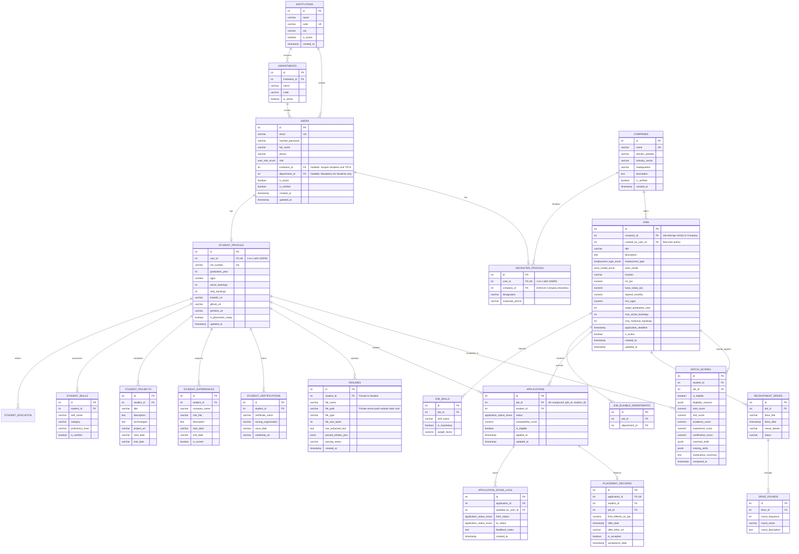

# Database Design Document
## AI-Powered Placement Intelligence System

**Document Version:** 1.1.0  
**Target RDBMS:** PostgreSQL 15+  
**ORM:** SQLAlchemy 2.0  
**Migration Tool:** Alembic  

---

## 1. Design Principles & Normalization Strategy

The database schema is designed to balance strict 3rd Normal Form (3NF) relational integrity with query performance required for the Placement Intelligence Engine.

### Core Tenets:
1. **Relational Integrity & Multi-Tenancy Scope:** Foreign keys, `NOT NULL` constraints, check constraints, and cascade delete rules prevent orphaned records. Institutional multi-tenancy is enforced through `institution_id` on `users`, bounding TPOs to their authorized institution.
2. **Explicit Enums:** Critical domain statuses (User Role, Application Status, Work Model, Employment Type) use strongly-typed PostgreSQL ENUMs.
3. **Explicit Department & Institution Nullability:** `department_id` is explicitly nullable in `users` (mandatory only for Students; `NULL` for Admins, Recruiters, and TPOs who oversee the entire institution).
4. **Optimized for Deterministic Querying:** Student academic metrics (CGPA, active backlogs, graduation year) are indexed with composite B-Tree indexes to enable instant cohort-level eligibility filtering across thousands of students.
5. **Structured JSONB for Unstructured AI Artifacts:** Rich semi-structured data (raw AI resume extraction output, detailed score explanations, and interview roadmaps) are stored as JSONB to provide schema flexibility without violating relational normalization for core business fields.

---

## 2. Mermaid Entity-Relationship (ER) Diagram



---

## 3. Entity Relationships, Scoping & Ownership Hierarchy

To prevent unauthorized cross-tenant data leaks, the database schema implements explicit ownership links:

```
[INSTITUTION]
   ├── [DEPARTMENTS]
   │       └── [USERS: Role=Student] ── 1:1 ── [STUDENT_PROFILES]
   │                                                   ├── [RESUMES] (Private)
   │                                                   ├── [SKILLS/PROJECTS/EXP/CERTS]
   │                                                   └── [APPLICATIONS] ──┐
   └── [USERS: Role=TPO] (Scoped to Institution)                            │
                                                                            │
[COMPANIES]                                                                 │
   ├── [USERS: Role=Recruiter] ── 1:1 ── [RECRUITER_PROFILES]              │
   └── [JOBS] ──────────────────────────────────────────────────────────────┘
           └── [APPLICATIONS] (Recruiter can access ONLY if job.company_id == recruiter.company_id)
```

### 3.1 Relationships and Ownership Rules
1. **Institutions to Departments:** 1-to-Many (`departments.institution_id` -> `institutions.id`). An institution contains academic departments.
2. **Institutions to Users:** 1-to-Many (`users.institution_id` -> `institutions.id`). 
   - Mandatory for **Students** and **TPOs**.
   - Binds a TPO strictly to their own collegiate institution. A TPO cannot view or administer students, drives, or statistics from another institution.
   - `NULL` for Recruiters and system Admins.
3. **Departments to Users:** 1-to-Many (`users.department_id` -> `departments.id`).
   - **`department_id` is explicitly NULLABLE.**
   - Mandatory for **Students** to record their enrolled academic branch (e.g., Computer Science).
   - Set to `NULL` for **TPOs** (who manage all departments across the institution), **Recruiters** (who are external corporate entities), and **Admins** (who maintain the system).
4. **Users to Student Profiles:** 1-to-1 (`student_profiles.user_id` -> `users.id` with `UNIQUE` constraint). Each student user maps to exactly one academic profile.
5. **Users to Recruiter Profiles:** 1-to-1 (`recruiter_profiles.user_id` -> `users.id` with `UNIQUE` constraint).
6. **Companies to Recruiter Profiles:** 1-to-Many (`recruiter_profiles.company_id` -> `companies.id`). A company may have multiple authorized recruiters.
7. **Companies to Jobs:** 1-to-Many (`jobs.company_id` -> `companies.id`). A job posting is owned by a single company.
8. **Recruiters to Applicant Data (Ownership Boundary):** Recruiters can query applications and candidate resumes **only** where `applications.job_id = jobs.id` and `jobs.company_id = recruiter.company_id`. Cross-company applicant snooping is mathematically prohibited by this join condition.
9. **Students to Private Data (Ownership Boundary):** Resumes, profile data, and applications belong strictly to the student (`student_id = student_profiles.id`). Students cannot query or read other students' resumes or applications.

---

## 4. Data Dictionary and Table Specifications

### 4.1 `institutions` & `departments`
- **`institutions`**: Represents the collegiate organization.
  - `id` (SERIAL, PK)
  - `name` (VARCHAR(255), NOT NULL)
  - `code` (VARCHAR(50), NOT NULL, UNIQUE) — e.g. "INST-01"
  - `city` (VARCHAR(100), NOT NULL)
  - `is_active` (BOOLEAN, DEFAULT TRUE)
  - `created_at` (TIMESTAMPTZ, DEFAULT NOW())

- **`departments`**: Academic branches within an institution.
  - `id` (SERIAL, PK)
  - `institution_id` (INTEGER, FK -> `institutions.id`, ON DELETE CASCADE)
  - `name` (VARCHAR(150), NOT NULL) — e.g. "Computer Science & Engineering"
  - `code` (VARCHAR(20), NOT NULL) — e.g. "CSE"
  - `is_active` (BOOLEAN, DEFAULT TRUE)
  - *Constraints:* UNIQUE(`institution_id`, `code`)

### 4.2 `users`
Central authentication identity table supporting all 4 roles.
- `id` (SERIAL, PK)
- `email` (VARCHAR(255), NOT NULL, UNIQUE)
- `hashed_password` (VARCHAR(255), NOT NULL)
- `full_name` (VARCHAR(150), NOT NULL)
- `phone` (VARCHAR(20), NULL)
- `role` (ENUM: `'student'`, `'tpo'`, `'recruiter'`, `'admin'`, NOT NULL)
- `institution_id` (INTEGER, NULL, FK -> `institutions.id`, ON DELETE SET NULL) — **Required for Students & TPOs; NULL for Recruiters & Admins.**
- `department_id` (INTEGER, NULL, FK -> `departments.id`, ON DELETE SET NULL) — **Explicitly NULLABLE. Mandatory for Students only; NULL for TPOs, Recruiters, Admins.**
- `is_active` (BOOLEAN, DEFAULT TRUE)
- `is_verified` (BOOLEAN, DEFAULT FALSE)
- `created_at` (TIMESTAMPTZ, DEFAULT NOW())
- `updated_at` (TIMESTAMPTZ, DEFAULT NOW())

### 4.3 `student_profiles`
Normalized student academic and career readiness record.
- `id` (SERIAL, PK)
- `user_id` (INTEGER, NOT NULL, UNIQUE, FK -> `users.id`, ON DELETE CASCADE)
- `roll_number` (VARCHAR(50), NOT NULL, UNIQUE)
- `graduation_year` (INTEGER, NOT NULL) — e.g. 2026
- `cgpa` (NUMERIC(4, 2), NOT NULL, CHECK (cgpa >= 0.0 AND cgpa <= 10.0))
- `active_backlogs` (INTEGER, DEFAULT 0, CHECK (active_backlogs >= 0))
- `total_backlogs` (INTEGER, DEFAULT 0, CHECK (total_backlogs >= 0))
- `linkedin_url` (VARCHAR(255), NULL)
- `github_url` (VARCHAR(255), NULL)
- `portfolio_url` (VARCHAR(255), NULL)
- `is_placement_ready` (BOOLEAN, DEFAULT TRUE)
- `updated_at` (TIMESTAMPTZ, DEFAULT NOW())

### 4.4 Student Portfolio Sub-Tables
Normalized entities linked to `student_profiles.id`:
- **`student_education`**:
  - `id` (SERIAL, PK), `student_id` (FK -> `student_profiles.id`, CASCADE), `institution_name` (VARCHAR(200)), `degree` (VARCHAR(150)), `field_of_study` (VARCHAR(150), NULL), `start_year` (INTEGER, NULL), `end_year` (INTEGER, NULL), `cgpa_or_percentage` (VARCHAR(50), NULL), `created_at` (TIMESTAMPTZ), `updated_at` (TIMESTAMPTZ).
- **`student_skills`**:
  - `id` (SERIAL, PK), `student_id` (FK -> `student_profiles.id`, CASCADE), `skill_name` (VARCHAR(100)), `category` (VARCHAR(50)), `proficiency_level` (VARCHAR(20)), `is_verified` (BOOLEAN, DEFAULT FALSE).
  - *Constraint:* UNIQUE(`student_id`, `skill_name`)
- **`student_projects`**:
  - `id` (SERIAL, PK), `student_id` (FK), `title` (VARCHAR(200)), `description` (TEXT), `technologies` (TEXT), `project_url` (VARCHAR(255)), `start_date` (VARCHAR(30)), `end_date` (VARCHAR(30)).
- **`student_experiences`**:
  - `id` (SERIAL, PK), `student_id` (FK), `company_name` (VARCHAR(200)), `role_title` (VARCHAR(150)), `description` (TEXT), `start_date` (VARCHAR(30)), `end_date` (VARCHAR(30)), `is_current` (BOOLEAN).
- **`student_certifications`**:
  - `id` (SERIAL, PK), `student_id` (FK), `certificate_name` (VARCHAR(255)), `issuing_organization` (VARCHAR(200)), `issue_date` (VARCHAR(30)), `credential_url` (VARCHAR(255)).

### 4.5 `resumes`
Stores physical file references and extracted metadata for uploaded student CVs.
- `id` (SERIAL, PK)
- `student_id` (INTEGER, NOT NULL, FK -> `student_profiles.id`, ON DELETE CASCADE)
- `file_name` (VARCHAR(255), NOT NULL)
- `file_path` (VARCHAR(500), NOT NULL) — **Private backend filesystem path outside static public web directory**
- `file_type` (VARCHAR(10), NOT NULL) — 'pdf' or 'docx'
- `file_size_bytes` (INTEGER, NOT NULL, CHECK (file_size_bytes <= 5242880)) — Max 5MB
- `raw_extracted_text` (TEXT, NULL)
- `parsed_entities_json` (JSONB, NULL)
- `parsing_status` (VARCHAR(50), DEFAULT 'pending') — 'pending', 'extracted', 'synced', 'failed'
- `created_at` (TIMESTAMPTZ, DEFAULT NOW())

### 4.6 `companies` & `recruiter_profiles`
- **`companies`**:
  - `id` (SERIAL, PK), `name` (VARCHAR(200), UNIQUE), `domain_website` (VARCHAR(255)), `industry_sector` (VARCHAR(100)), `headquarters` (VARCHAR(100)), `description` (TEXT), `is_verified` (BOOLEAN, DEFAULT TRUE), `created_at` (TIMESTAMPTZ, DEFAULT NOW()).
- **`recruiter_profiles`**:
  - `id` (SERIAL, PK), `user_id` (INTEGER, UNIQUE, FK -> `users.id`, CASCADE), `company_id` (INTEGER, NOT NULL, FK -> `companies.id`, CASCADE), `designation` (VARCHAR(100)), `corporate_phone` (VARCHAR(30)).

### 4.7 `jobs`, `job_skills`, `job_eligible_departments`
- **`jobs`**:
  - `id` (SERIAL, PK)
  - `company_id` (INTEGER, NOT NULL, FK -> `companies.id`, CASCADE)
  - `created_by_user_id` (INTEGER, NOT NULL, FK -> `users.id`, RESTRICT)
  - `title` (VARCHAR(200), NOT NULL)
  - `description` (TEXT, NOT NULL)
  - `employment_type` (ENUM: `'full_time'`, `'internship'`, `'intern_to_full_time'`, NOT NULL)
  - `work_model` (ENUM: `'on_site'`, `'hybrid'`, `'remote'`, NOT NULL)
  - `location` (VARCHAR(150), NOT NULL)
  - `ctc_lpa` (NUMERIC(6, 2), NOT NULL)
  - `base_salary_lpa` (NUMERIC(6, 2), NULL)
  - `stipend_monthly` (NUMERIC(8, 2), NULL)
  - `min_cgpa` (NUMERIC(4, 2), DEFAULT 0.0)
  - `target_graduation_year` (INTEGER, NOT NULL)
  - `max_active_backlogs` (INTEGER, DEFAULT 0)
  - `max_historical_backlogs` (INTEGER, DEFAULT 0)
  - `application_deadline` (TIMESTAMPTZ, NOT NULL)
  - `is_active` (BOOLEAN, DEFAULT TRUE)
  - `created_at` (TIMESTAMPTZ, DEFAULT NOW())
  - `updated_at` (TIMESTAMPTZ, DEFAULT NOW())

- **`job_skills`**:
  - `id` (SERIAL, PK)
  - `job_id` (INTEGER, NOT NULL, FK -> `jobs.id`, CASCADE)
  - `skill_name` (VARCHAR(100), NOT NULL)
  - `is_mandatory` (BOOLEAN, DEFAULT TRUE)
  - `weight_factor` (NUMERIC(3, 2), DEFAULT 1.0)
  - *Constraint:* UNIQUE(`job_id`, `skill_name`)

- **`job_eligible_departments`**:
  - `id` (SERIAL, PK)
  - `job_id` (INTEGER, NOT NULL, FK -> `jobs.id`, CASCADE)
  - `department_id` (INTEGER, NOT NULL, FK -> `departments.id`, CASCADE)
  - *Constraint:* UNIQUE(`job_id`, `department_id`)

### 4.8 `applications` & `application_stage_logs`
- **`applications`**:
  - `id` (SERIAL, PK)
  - `job_id` (INTEGER, NOT NULL, FK -> `jobs.id`, CASCADE)
  - `student_id` (INTEGER, NOT NULL, FK -> `student_profiles.id`, CASCADE)
  - `status` (ENUM: `'applied'`, `'under_review'`, `'shortlisted'`, `'interview_scheduled'`, `'selected'`, `'rejected'`, `'withdrawn'`, DEFAULT `'applied'`)
  - `compatibility_score` (NUMERIC(5, 2), NULL) — Snapshot of match score at application
  - `is_eligible` (BOOLEAN, DEFAULT TRUE)
  - `applied_at` (TIMESTAMPTZ, DEFAULT NOW())
  - `updated_at` (TIMESTAMPTZ, DEFAULT NOW())
  - *CRITICAL CONSTRAINT:* **`UNIQUE(job_id, student_id)`** (Strict duplicate prevention)

- **`application_stage_logs`**:
  - `id` (SERIAL, PK)
  - `application_id` (INTEGER, NOT NULL, FK -> `applications.id`, CASCADE)
  - `updated_by_user_id` (INTEGER, NOT NULL, FK -> `users.id`, RESTRICT)
  - `from_status` (VARCHAR(50), NOT NULL)
  - `to_status` (VARCHAR(50), NOT NULL)
  - `feedback_notes` (TEXT, NULL)
  - `created_at` (TIMESTAMPTZ, DEFAULT NOW())

### 4.9 `match_scores` (Intelligence Cache)
Stores calculated compatibility analyses to prevent redundant scoring re-computations.
- `id` (SERIAL, PK)
- `student_id` (INTEGER, NOT NULL, FK -> `student_profiles.id`, CASCADE)
- `job_id` (INTEGER, NOT NULL, FK -> `jobs.id`, CASCADE)
- `is_eligible` (BOOLEAN, NOT NULL)
- `eligibility_reasons` (JSONB, NOT NULL)
- `total_score` (NUMERIC(5, 2), NOT NULL) — 0.0 to 100.0
- `skill_score` (NUMERIC(5, 2), NOT NULL)
- `academic_score` (NUMERIC(5, 2), NOT NULL)
- `experience_score` (NUMERIC(5, 2), NOT NULL)
- `certification_score` (NUMERIC(5, 2), NOT NULL)
- `matched_skills` (JSONB, NOT NULL)
- `missing_skills` (JSONB, NOT NULL)
- `explanation_summary` (TEXT, NULL)
- `computed_at` (TIMESTAMPTZ, DEFAULT NOW())
- *Constraint:* UNIQUE(`student_id`, `job_id`)

### 4.10 `placement_records`
Official institutional record of an accepted job offer.
- `id` (SERIAL, PK)
- `application_id` (INTEGER, NOT NULL, UNIQUE, FK -> `applications.id`, CASCADE)
- `student_id` (INTEGER, NOT NULL, FK -> `student_profiles.id`, CASCADE)
- `job_id` (INTEGER, NOT NULL, FK -> `jobs.id`, CASCADE)
- `final_offered_ctc_lpa` (NUMERIC(6, 2), NOT NULL)
- `offer_date` (TIMESTAMPTZ, DEFAULT NOW())
- `offer_letter_url` (VARCHAR(500), NULL)
- `is_accepted` (BOOLEAN, DEFAULT TRUE)
- `acceptance_date` (TIMESTAMPTZ, DEFAULT NOW())

---

## 5. Performance Indexing Strategy

```sql
-- 1. Authentication & Security & Multi-Tenancy Scoping
CREATE INDEX idx_users_email ON users(email);
CREATE INDEX idx_users_role ON users(role);
CREATE INDEX idx_users_institution_id ON users(institution_id);
CREATE INDEX idx_users_department_id ON users(department_id);

-- 2. Fast Student Cohort Eligibility Lookups
CREATE INDEX idx_student_eligibility ON student_profiles(graduation_year, cgpa, active_backlogs);
CREATE INDEX idx_student_user_id ON student_profiles(user_id);

-- 3. Job Filtering & Active Deadlines
CREATE INDEX idx_jobs_active_deadline ON jobs(is_active, application_deadline);
CREATE INDEX idx_jobs_company_id ON jobs(company_id);
CREATE INDEX idx_jobs_target_year ON jobs(target_graduation_year);

-- 4. Application Pipeline & Recruiter/Student Scoped Lookups
CREATE INDEX idx_applications_job_status ON applications(job_id, status);
CREATE INDEX idx_applications_student_status ON applications(student_id, status);

-- 5. Intelligence Engine Matching Cache
CREATE INDEX idx_match_scores_lookup ON match_scores(student_id, job_id);
CREATE INDEX idx_match_scores_job_ranked ON match_scores(job_id, is_eligible, total_score DESC);
```
