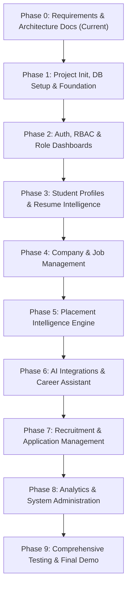

# Phased Development Roadmap & Implementation Plan
## AI-Powered Placement Intelligence System

**Document Version:** 1.0.0  
**Methodology:** Incremental Phased Delivery with Verification Gates  
**Architecture:** Modular Monolith (FastAPI + React + PostgreSQL)  

---

## 1. Roadmap Overview & Phasing Strategy

To ensure zero architectural drift, each phase delivers a tangible, testable capability. Subsequent phases build strictly upon the verified foundation of preceding phases.

---

## 2. Detailed Phase Specifications

### Phase 0: Requirements and Architecture Documentation (Current)
- **Objective:** Finalize all technical blueprints, database models, API contracts, and architectural guardrails before writing production code.
- **Deliverables:**
  - `docs/SRS.md`
  - `docs/SYSTEM_ARCHITECTURE.md`
  - `docs/DATABASE_DESIGN.md`
  - `docs/API_SPECIFICATION.md`
  - `docs/UI_UX_PLAN.md`
  - `docs/DEVELOPMENT_ROADMAP.md`
  - `docs/PROJECT_DECISIONS.md`
- **Acceptance Criteria:** All documentation is cross-consistent, adheres to modular monolith principles, and is approved by the user.

---

### Phase 1: Project Initialization, Database Setup, Configuration & Foundation
- **Features:**
  - Creation of `/backend` and `/frontend` project trees.
  - Setup of Python virtual environment (`.venv`), `pyproject.toml` / `requirements.txt`.
  - Backend configuration management with `pydantic-settings` reading `.env`.
  - Database connectivity setup using SQLAlchemy 2.0 with connection pooling.
  - Alembic initialization and base database migration for foundational tables (`institutions`, `departments`, `users`).
  - Frontend scaffolding with Vite, React 18, TypeScript, and Tailwind CSS configuration.
  - CORS configuration and basic API health check endpoint (`/health`).
- **Files Affected:**
  - `backend/app/config.py`, `backend/app/main.py`, `backend/app/core/database.py`
  - `backend/alembic/*`
  - `frontend/package.json`, `frontend/vite.config.ts`, `frontend/tailwind.config.js`, `frontend/src/App.tsx`
- **Dependencies:** PostgreSQL local database instance running.
- **Acceptance Criteria:**
  - `GET /health` returns `{"status": "healthy", "database": "connected"}`.
  - Frontend renders a styled Tailwind landing view connected to backend health endpoint.
  - Alembic successfully executes `alembic upgrade head` without errors.
- **Tests Required:** Backend database ping test; Vite build compilation test.

---

### Phase 2: Authentication, Role-Based Access Control & Dashboard Shells
- **Features:**
  - Secure password hashing using Passlib (Bcrypt).
  - JWT token generation, signature verification, and expiration handling.
  - User registration (`/auth/register`) and login (`/auth/login`).
  - FastAPI dependency injection guards: `get_current_user`, `require_role(["student", "tpo", ...])`.
  - Frontend Auth Context and persistent session management.
  - Protected route wrappers in React Router (`ProtectedRoute.tsx`).
  - Role-specific dashboard scaffold layouts with active sidebar and topbar shells for all 4 roles.
- **Files Affected:**
  - `backend/app/modules/auth/*`, `backend/app/core/security.py`, `backend/app/core/dependencies.py`
  - `frontend/src/context/AuthContext.tsx`, `frontend/src/routes/*`, `frontend/src/layouts/*`
  - `frontend/src/pages/auth/*`, `frontend/src/pages/dashboard/*`
- **Dependencies:** Phase 1 database tables.
- **Acceptance Criteria:**
  - Student and Recruiter can register and login.
  - Accessing `/tpo/dashboard` with a Student token returns HTTP 403 Forbidden.
  - Frontend redirects unauthenticated users to `/login` and role-routes authenticated users to their specific dashboard.
- **Tests Required:** Unit tests for password hashing and JWT encoding; API integration tests for `/auth/login` valid/invalid credentials.

---

### Phase 3: Student Profiles and Resume Intelligence (M1 & M2)
- **Features:**
  - Complete student profile CRUD endpoints (academic info, skills, projects, certifications, experiences).
  - Resume upload endpoint (`/resumes/upload`) supporting `.pdf` and `.docx` up to 5MB.
  - Local text extraction service using `PyMuPDF` (`fitz`) and `python-docx`.
  - Abstracted AI resume entity extraction generating standardized JSON.
  - Interactive frontend resume upload drop-zone, extraction preview, and side-by-side verification editor.
  - Profile synchronization endpoint (`/resumes/{id}/sync-profile`).
- **Files Affected:**
  - `backend/app/modules/resumes/*`, `backend/app/modules/users/*`, `backend/app/services/document_parser.py`
  - `frontend/src/pages/student/ProfilePage.tsx`, `frontend/src/pages/student/ResumePage.tsx`
- **Dependencies:** Phase 2 authentication and user models.
- **Acceptance Criteria:**
  - Uploading a PDF resume extracts clean text locally in < 1.5 seconds.
  - AI extraction extracts skills, projects, and education into valid Pydantic models without hallucinations.
  - Student confirms extraction, successfully populating `student_skills` and `student_projects` in PostgreSQL.
- **Tests Required:** Parser unit tests on sample PDF and DOCX files; integration test for profile sync transaction.

---

### Phase 4: Company and Job Management (M3)
- **Features:**
  - Company registry endpoints (CRUD) with TPO verification flag.
  - Recruiter company association.
  - Job creation wizard and editing endpoints with cutoff parameters:
    - Minimum CGPA, target graduation year, max active/historical backlogs, eligible departments.
    - Mandatory and weighted required skills.
  - Student job catalog with search, branch filtering, and active deadline filtering.
  - Recruiter job dashboard displaying active, draft, and closed postings.
- **Files Affected:**
  - `backend/app/modules/companies/*`, `backend/app/modules/jobs/*`
  - `frontend/src/pages/recruiter/JobsPage.tsx`, `frontend/src/pages/student/JobsExplorePage.tsx`
- **Dependencies:** Phase 2 RBAC and company database schema.
- **Acceptance Criteria:**
  - Recruiters can publish jobs with specific cutoffs and skill requirements.
  - Students cannot edit or delete job postings.
  - Expired jobs are automatically excluded from active student listings.
- **Tests Required:** Job creation payload validation tests; department association tests.

---

### Phase 5: Placement Intelligence Engine (M4)
- **Features:**
  - Pure Python deterministic eligibility rule engine (CGPA, Branch, Graduation Year, Backlogs).
  - Weighted compatibility scoring engine:
    - 50% Technical Skills overlap (exact and category-aware match).
    - 20% Academic compatibility.
    - 20% Projects and experience alignment.
    - 10% Certifications and additional competencies.
  - Skill-gap analyzer (classifying matched, missing mandatory, and recommended skills).
  - Explainability generator providing clear rationale for match scores.
  - Cached match score computation in `match_scores` table.
  - Frontend integration: Eligibility badges (`Eligible` vs. `Ineligible: Reason`), Compatibility Score Ring, and Skill Gap radar.
- **Files Affected:**
  - `backend/app/modules/intelligence/*`, `backend/app/services/matching_engine.py`
  - `frontend/src/components/intelligence/*`, `frontend/src/pages/student/JobDetailPage.tsx`
- **Dependencies:** Phase 3 student profile data and Phase 4 job criteria.
- **Acceptance Criteria:**
  - A student with CGPA 7.0 applying to a 7.5 cutoff job receives `is_eligible: false` with explicit reason, but still receives an accurate skill compatibility score (e.g., 85%).
  - Deterministic evaluation executes in < 50ms.
- **Tests Required:** Exhaustive unit test suite covering boundary conditions (CGPA edge cases, backlogs, branch mismatches).

---

### Phase 6: Gemini & OpenAI Integration and AI Career Assistant (M5)
- **Features:**
  - Concrete implementation of `BaseAIProvider` for:
    - `GeminiProvider` (Google Gemini API).
    - `OpenAIProvider` (OpenAI API).
    - `MockAIProvider` (Offline deterministic mock provider).
  - Configuration-based provider selection (`AI_PROVIDER=gemini|openai|mock`).
  - Structured prompt templates for Career Q&A, Interview Preparation (Technical & HR), and Personalized Learning Roadmaps.
  - Strict timeout (15s), retry handling, and explicit exception bubbling (no silent fallback).
  - Student interactive Career Assistant chat interface and Roadmap visualizer in React.
- **Files Affected:**
  - `backend/app/core/ai/*`, `backend/app/modules/ai_assistant/*`
  - `frontend/src/pages/student/CareerAssistantPage.tsx`
- **Dependencies:** Phase 5 skill-gap data.
- **Acceptance Criteria:**
  - Switching `AI_PROVIDER=mock` allows full UI workflow without internet or API keys.
  - Assistant responds with tailored technical interview questions based on the candidate's actual projects.
  - Learning roadmap outputs phased 2-week/4-week actionable study goals for missing skills.
- **Tests Required:** AI Provider interface contract tests; mock provider unit tests; error propagation test on invalid API key.

---

### Phase 7: Placement and Recruitment Management (M6)
- **Features:**
  - Job application submission endpoint with duplicate application guard (`UNIQUE(job_id, student_id)`).
  - Recruitment drive scheduler and multi-round pipeline tracker (`drive_rounds`).
  - Recruiter applicant review console with candidate sorting by Compatibility Score and eligibility filtering.
  - Stage advance workflow: `Applied` -> `Under Review` -> `Shortlisted` -> `Interview Scheduled` -> `Selected` / `Rejected`.
  - Student application status history tracker and real-time status badges.
  - Offer finalization and official placement record creation.
- **Files Affected:**
  - `backend/app/modules/applications/*`, `backend/app/modules/drives/*`
  - `frontend/src/pages/recruiter/PipelinePage.tsx`, `frontend/src/pages/student/MyApplicationsPage.tsx`
- **Dependencies:** Phase 4 jobs, Phase 5 intelligence scoring.
- **Acceptance Criteria:**
  - Submitting a duplicate application returns HTTP 409 Conflict.
  - Recruiter can transition student status with feedback notes.
  - Selected candidates can be recorded as official institutional placements.
- **Tests Required:** Database constraint violation tests; application state machine transition tests.

---

### Phase 8: Analytics and Administration
- **Features:**
  - TPO campus placement KPI dashboard and department-level aggregations.
  - Interactive Recharts bar and pie visualizations for branch-wise placement percentages.
  - Admin user management portal (role assignment, account activation/deactivation).
  - System diagnostics and AI provider status display.
  - Data export capabilities (CSV of placed/unplaced students for college records).
- **Files Affected:**
  - `backend/app/modules/analytics/*`, `backend/app/modules/admin/*`
  - `frontend/src/pages/tpo/AnalyticsPage.tsx`, `frontend/src/pages/admin/AdminDashboardPage.tsx`
- **Dependencies:** Phase 7 application and placement data.
- **Acceptance Criteria:**
  - TPO dashboard accurately calculates placement percentage and average CTC across departments.
  - Admin can deactivate user accounts and audit system activities.
- **Tests Required:** Aggregation query performance tests; RBAC authorization verification on admin routes.

---

### Phase 9: Comprehensive Testing, Documentation & Final Demonstration
- **Features:**
  - End-to-end integration testing covering the 6 core user demonstration journeys (Journey A through F from SRS).
  - Codebase cleanup, documentation polishing, and creation of `README.md` with complete setup instructions.
  - Creation of seed data script (`seed_data.py`) populating sample students, departments, companies, jobs, and applications for instant demonstration.
  - Production build verification (`npm run build` and `uvicorn` production readiness check).
- **Files Affected:**
  - `backend/scripts/seed_data.py`, `README.md`
- **Dependencies:** All previous phases.
- **Acceptance Criteria:**
  - All automated tests pass.
  - Seed script populates realistic college placement data within 5 seconds.
  - A flawless, end-to-end live demonstration can be executed locally on Windows.
- **Tests Required:** Full suite automated regression testing (`pytest`), frontend production build validation.

