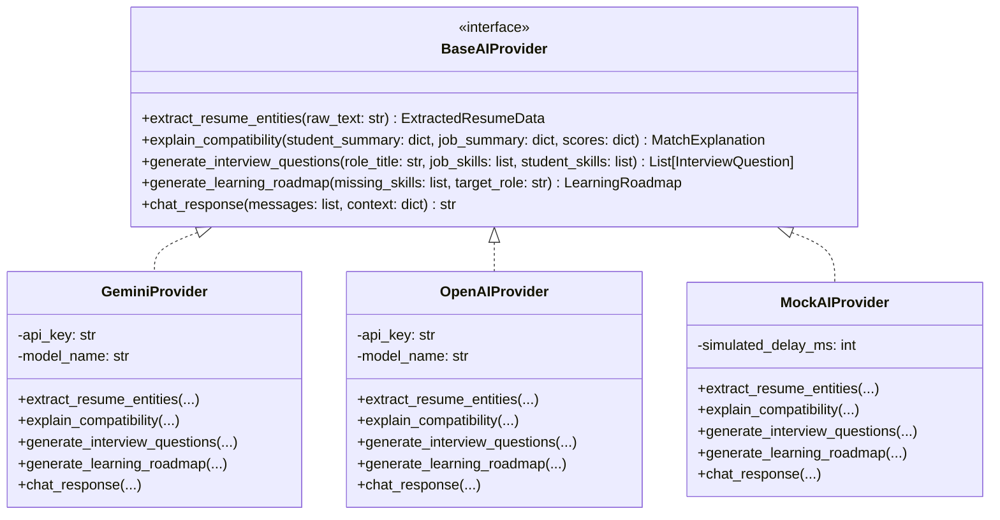

# System Architecture Document
## AI-Powered Placement Intelligence System

**Document Version:** 1.1.0  
**Status:** Approved Architecture Blueprint  
**Target Environment:** Academic Minor Project / Production-Grade Modular Monolith  

---

## 1. High-Level Architectural Pattern: Modular Monolith

The AI-Powered Placement Intelligence System is designed strictly as a **Modular Monolith**. 

Instead of overcomplicating an academic project with distributed microservices, message queues (Celery/RabbitMQ), caching daemons (Redis), or container orchestrators (Docker/Kubernetes), this architecture consolidates all business logic into a single cohesive, high-performance Python FastAPI backend, a modern React TypeScript frontend, and a centralized PostgreSQL relational database.

```mermaid
graph TD
    subgraph Client Tier ["Client Application Tier (Port 5173)"]
        UI["React 18 + TypeScript SPA\n(Vite + Tailwind CSS + React Router)"]
        State["State Management & API Client\n(React Query / Axios Interceptors)"]
        UI --> State
    end

    subgraph API Gateway ["API & Security Boundary (Port 8000)"]
        FastAPI["FastAPI Core Application"]
        CORS["CORS Middleware"]
        AuthMid["JWT Auth & Scoped RBAC Dependency Guard"]
        FastAPI --> CORS
        FastAPI --> AuthMid
    end

    subgraph Modules ["Backend Modular Monolith (app/modules)"]
        M1["M1: Auth & User Profiles\n(Multi-Tenant Scoping)"]
        M2["M2: Resume Intelligence\n(PyMuPDF + python-docx)"]
        M3["M3: Company & Job Management"]
        M4["M4: Placement Intelligence Engine\n(Deterministic Rules + Scoring)"]
        M5["M5: AI Career Assistant\n(Context & Dynamic Prompts)"]
        M6["M6: Recruitment & Application Pipeline"]
    end

    subgraph AI Layer ["Abstracted AI Provider Layer (app/core/ai)"]
        AIFactory["AI Provider Factory\n(Reads Config via Environment)"]
        BaseAI["<<Interface>> BaseAIProvider"]
        Gemini["Google Gemini Provider\n(Model: GEMINI_MODEL env)"]
        OpenAI["OpenAI Provider\n(Model: OPENAI_MODEL env)"]
        MockAI["Mock AI Provider\n(Offline / Deterministic Test Mode)"]

        AIFactory --> BaseAI
        BaseAI <|-- Gemini
        BaseAI <|-- OpenAI
        BaseAI <|-- MockAI
    end

    subgraph Data Tier ["Persistence & Storage Tier"]
        DB[(PostgreSQL 15+\nRelational Storage)]
        ORM["SQLAlchemy 2.0 ORM + Alembic Migrations"]
        Storage["Private Backend Storage\n(/backend/uploads/resumes/ - Git Excluded)"]
        ORM --> DB
    end

    State -->|"HTTPS / REST (JSON) + Bearer Token"| FastAPI
    AuthMid --> Modules
    M2 -->|"Raw Document Text"| AIFactory
    M4 -->|"Explainability Prompts"| AIFactory
    M5 -->|"Career Coaching Prompts"| AIFactory
    M1 & M2 & M3 & M4 & M6 --> ORM
    M2 -->|"Private File Storage"| Storage
```

---

## 2. Component Breakdown and Responsibilities

### 2.1 Frontend Application (`/frontend`)
- **Technology Stack:** React 18, TypeScript, Vite, Tailwind CSS, Lucide React Icons, Recharts.
- **Role:** Single Page Application (SPA) providing reactive, role-tailored user interfaces for Students, TPOs, Recruiters, and Administrators.
- **State Management:** Context API for session and authentication; React Query (TanStack Query) / Axios for server-state caching, optimistic updates, and automatic token attachment.
- **Routing:** React Router v6 with strict client-side Protected Route guards enforcing role permissions before component rendering.

### 2.2 Backend Application (`/backend`)
- **Technology Stack:** Python 3.11+, FastAPI, Pydantic v2, SQLAlchemy 2.0, Passlib/Bcrypt, PyJWT.
- **Role:** Exposes clean RESTful API endpoints, coordinates domain services, executes business rules, enforces database transactions, manages private file streaming, and orchestrates external AI provider interactions.
- **Execution Model:** Asynchronous execution (`async def`) powered by Uvicorn ASGI server for high-concurrency I/O operations (file uploads, database access, external LLM calls).

### 2.3 Database & Migrations (`/backend/alembic`)
- **Technology Stack:** PostgreSQL 15+, SQLAlchemy ORM, Alembic.
- **Role:** Enforces relational integrity, institutional scoping, foreign key cascades, unique constraints, and optimized B-Tree and GIN indexes.
- **Migration Strategy:** Version-controlled Alembic migrations guarantee deterministic database schema evolution across developer machines.

---

## 3. Authorization and Data Ownership Architecture

Data access control is enforced at the service layer and dependency injection layer using a strict multi-tier data ownership model:

```
[System Administrator]
   │  └── Platform-wide user management, institutional metadata, system health & AI diagnostics.
   │      (Cannot alter student application status or company selection records).
   │
   ├── [Institution Scope: TPO]
   │      └── Scoped strictly to: users.institution_id == current_user.institution_id.
   │          (Cannot view, edit, or audit students, drives, or statistics of other colleges).
   │
   ├── [Corporate Scope: Recruiter]
   │      └── Scoped strictly to: jobs.company_id == current_user.recruiter_profile.company_id.
   │          (Can view ONLY applicants who applied to their company's job postings).
   │
   └── [Private Scope: Student]
          └── Scoped strictly to: student_profiles.user_id == current_user.id.
              (Can access ONLY their own resume, profile, and application history).
```

### 3.1 Role Access Matrix

| Domain Resource | Student | Recruiter | TPO (Placement Officer) | Administrator |
| :--- | :--- | :--- | :--- | :--- |
| **Own Profile** | Read / Write | Read / Write (Recruiter profile) | Read / Write | Read / Write |
| **Other Student Profiles** | No Access | Read-Only (Applicants to own jobs only) | Read-Only (Own institution only) | Read-Only |
| **Resume Upload & Sync** | Own resumes only | No Access | No Access | No Access |
| **Resume Binary Download** | Own resume only | Applicants to own jobs only | Students in own institution only | Audit Access |
| **Company Details** | Read-Only | Read / Write (Own company) | Read / Verify (Partner companies) | Read / Write |
| **Job Postings** | Read-Only (All active) | Read / Write (Own company jobs) | Read / Monitor (All campus drives) | Read / Audit |
| **Submit Application** | Own submission | No Access | No Access | No Access |
| **Application Pipeline** | Own status only | Read / Update (Applicants to own jobs) | Read / Monitor (Own institution) | Read-Only |
| **Placement Records** | Own offer only | Finalize (Selected applicants) | Verify & Record (Own institution) | Read / Audit |
| **Institutional Analytics** | No Access | No Access | Read-Only (Own institution) | Platform Stats |
| **User & Tenant Admin** | No Access | No Access | Manage batch/dept (Own institution) | Full Management |

### 3.2 Explicit Administrator Bounds
The Administrator role is custodian of infrastructure and tenancy:
- **Permitted:** Provisioning institutions, departments, creating/deactivating user accounts, resetting credentials, configuring AI provider keys/models, auditing error logs.
- **Prohibited:** Falsifying student academic records (CGPA/backlogs), submitting applications on behalf of students, or changing recruiter hiring decisions (Shortlisted/Selected/Rejected).

---

## 4. Private Resume Storage & Upload Security

Resume documents contain sensitive Personal Identifiable Information (PII) and must not be exposed to the public internet or stored in Git repositories.

```mermaid
sequenceDiagram
    autonumber
    actor Student as Student Client
    participant API as Backend Upload Route
    participant Val as File Validation Guard
    participant Disk as Private Local Storage (/backend/uploads/resumes/)
    participant DB as PostgreSQL
    actor Recruiter as Recruiter Client

    Student->>API: POST /api/v1/resumes/upload (multipart/form-data)
    API->>Val: Check file size (<= 5MB)
    Val-->>API: Size OK
    API->>Val: Verify MIME type & Magic Bytes (.pdf / .docx)
    Val-->>API: Extension & Magic Bytes match valid document
    API->>Disk: Save file as /backend/uploads/resumes/{student_id}_{uuid}.pdf
    Note over Disk: Path outside web static root; excluded via .gitignore
    API->>DB: Record Resume entry (file_path, file_size_bytes, parsing_status)
    API-->>Student: 200 OK (Upload Successful)

    Note over Recruiter: Recruiter attempts to view applicant's resume
    Recruiter->>API: GET /api/v1/resumes/{resume_id}/download (Bearer JWT)
    API->>DB: Query Resume -> Student -> Application -> Job -> Company
    alt Current Recruiter's company_id == Job's company_id
        API->>Disk: Read file binary stream
        API-->>Recruiter: HTTP 200 Stream (application/pdf)
    else Recruiter not authorized for this applicant
        API-->>Recruiter: HTTP 403 Forbidden ("Unauthorized access to applicant resume")
    end
```

### 4.1 Storage & Git Exclusion Rules
1. **Physical Location:** Resumes are saved in `backend/uploads/resumes/`. This directory is strictly outside the frontend public static folder and outside any public web server directory.
2. **Git Exclusion:** A root `.gitignore` file enforces that:
   - `backend/uploads/` and all contained `.pdf`, `.docx` files are excluded from version control.
   - All environment files (`.env`, `.env.local`, `.env.production`) containing database passwords and AI API keys are excluded.
3. **File Access Protection:** Direct HTTP access to file paths is disabled. Files can only be retrieved via authenticated FastAPI streaming endpoints (`GET /api/v1/resumes/{id}/download`) which enforce the ownership matrix described above.

### 4.2 Upload Validation Guardrails
- **File Size Restriction:** Strictly enforced maximum limit of **5 MB (5,242,880 bytes)**. Files exceeding this threshold are rejected immediately with HTTP 413 / 422 before memory buffering.
- **Allowed Extensions:** Strictly `.pdf` and `.docx`.
- **Content Inspection:** In addition to checking the filename extension, backend validation inspects the file header magic bytes:
  - PDF: `%PDF-` (`0x25 0x50 0x44 0x46`)
  - DOCX: PK ZIP header (`0x50 0x4B 0x03 0x04`)

---

## 5. Configurable AI Provider Architecture

To avoid vendor lock-in and prevent brittle hardcoding, **no model identifiers or API keys are hardcoded in application logic**. All provider and model settings are resolved at runtime via environment variables managed by Pydantic's `BaseSettings`.



### 5.1 Environment Configuration Schema
```bash
# ==============================================================================
# AI Provider Configuration (Independently Configurable)
# ==============================================================================
# Active provider selector: "gemini", "openai", or "mock"
AI_PROVIDER=mock

# Google Gemini Settings (Used when AI_PROVIDER=gemini)
GEMINI_API_KEY=your-gemini-api-key-here
GEMINI_MODEL=gemini-1.5-flash

# OpenAI Settings (Used when AI_PROVIDER=openai)
OPENAI_API_KEY=your-openai-api-key-here
OPENAI_MODEL=gpt-4o-mini

# Operational Parameters
AI_TIMEOUT_SECONDS=15
AI_MOCK_DELAY_MS=250
```

### 5.2 Architectural Guarantees for AI
1. **Dynamic Model Binding:** The `GeminiProvider` and `OpenAIProvider` classes read their model strings (`GEMINI_MODEL`, `OPENAI_MODEL`) dynamically from the validated `Settings` instance. Upgrading to a newer model (e.g. `gemini-2.0-flash` or `gpt-4o`) requires only updating `.env` without modifying Python code.
2. **Fail-Fast Policy (No Silent Fallback):** If the configured provider experiences an outage, network timeout, rate limit (HTTP 429), or authentication failure, it raises an explicit, logged `AIProviderError`. The application does **not** silently attempt to switch to another commercial provider, preventing billing anomalies and unpredictable response variations.
3. **Offline Mock Mode:** When `AI_PROVIDER=mock`, the application generates deterministic, realistic resume extractions, match explanations, and career roadmaps locally. This enables instant developer onboarding, automated regression testing, and reliable offline academic grading without external API dependencies.
