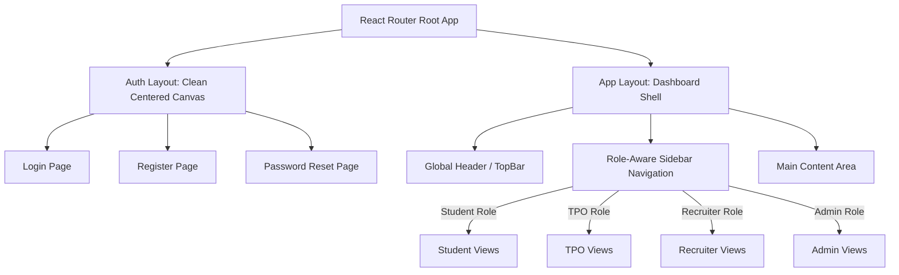

# UI/UX Architecture & Interface Plan
## AI-Powered Placement Intelligence System

**Document Version:** 1.0.0  
**Frontend Framework:** React 18 + TypeScript + Vite  
**Styling Framework:** Tailwind CSS  
**Component Library:** Custom headless reusable components + Lucide React Icons  
**Visualization Library:** Recharts  

---

## 1. Design System & Visual Foundation

The design system is tuned for a modern, high-credibility academic and enterprise recruitment platform. It leverages a crisp slate and indigo palette with clear status accent indicators.

### 1.1 Color Palette
- **Primary / Brand:**
  - Indigo 600 (`#4F46E5`): Primary buttons, active navigation, focus rings.
  - Indigo 500 (`#6366F1`): Hover states, interactive highlights.
  - Indigo 50 (`#EEF2FF`): Light background tints, active sidebar items.
- **Neutrals / Slate:**
  - Slate 900 (`#0F172A`): Primary headings, dark text, high-contrast titles.
  - Slate 700 (`#334155`): Body text, secondary labels.
  - Slate 500 (`#64748B`): Meta text, timestamps, placeholders.
  - Slate 200 (`#E2E8F0`): Card borders, table dividers, input outlines.
  - Slate 100 (`#F1F5F9`): Main dashboard background, secondary badges.
  - White (`#FFFFFF`): Card surfaces, modal containers.
- **Semantic Accents:**
  - **Success / Eligible / Selected:** Emerald 600 (`#059669`) / Emerald 50 (`#ECFDF5`)
  - **Warning / Review / Pending:** Amber 600 (`#D97706`) / Amber 50 (`#FFFBEB`)
  - **Danger / Ineligible / Rejected:** Rose 600 (`#E11D48`) / Rose 50 (`#FFF1F2`)
  - **Informational / Blue:** Sky 600 (`#0284C7`) / Sky 50 (`#F0F9FF`)

### 1.2 Typography & Sizing
- **Font Family:** `Inter, -apple-system, BlinkMacSystemFont, "Segoe UI", Roboto, sans-serif`
- **Scale:**
  - `Display / Page Title`: `text-2xl font-bold tracking-tight text-slate-900`
  - `Section Title`: `text-lg font-semibold text-slate-900`
  - `Card Header / Metric Title`: `text-sm font-medium text-slate-500`
  - `Body`: `text-sm text-slate-700 leading-relaxed`
  - `Caption / Badge`: `text-xs font-semibold uppercase tracking-wider`

### 1.3 Depth, Radius & Transitions
- **Border Radius:** `rounded-lg` (8px) for buttons, inputs, and badges; `rounded-xl` (12px) for cards and modals.
- **Shadows:** Tailwind `shadow-sm` for standard cards; `shadow-md` for dropdowns and popovers; `shadow-xl` for dialog modals.
- **Transitions:** Standard `transition-all duration-150 ease-in-out` for hover and focus micro-interactions.

---

## 2. Navigation Architecture & Role-Based Layouts

The application implements two primary top-level layouts:



### 2.1 Sidebar Navigation Structure by Role

| Student Navigation | TPO Navigation | Recruiter Navigation | Admin Navigation |
| :--- | :--- | :--- | :--- |
| • Dashboard | • Dashboard / Overview | • Dashboard | • Dashboard |
| • My Profile | • Student Directory | • Company Profile | • User Management |
| • Resume Intelligence | • Companies & Drives | • Job Postings | • Institutions & Depts |
| • Discover Jobs | • Jobs Management | • Candidate Pipeline | • System Health & AI |
| • My Applications | • Placement Analytics | • Interview Schedule | • Audit Logs |
| • AI Career Coach | • System Reports | • Candidate Search | • Settings |

---

## 3. Comprehensive Page List

### Public / Authentication Pages
1. `/login`: Clean split-screen card with email/password authentication, role badges, and registration links.
2. `/register`: Two-step registration wizard with role selector (Student vs. Recruiter) and immediate academic detail collection.
3. `/forgot-password`: Email recovery token request and reset confirmation.

### Student Experience (`/student/*`)
1. `/student/dashboard`: Core summary dashboard (profile health, top jobs, recent applications, quick coach).
2. `/student/profile`: Tabbed profile editor (Academic Details, Technical Skills, Projects, Certifications, Experience).
3. `/student/resume`: Upload drop-zone, PyMuPDF parser status, AI extraction side-by-side verification preview, and sync trigger.
4. `/student/jobs`: Job search directory with real-time filters (Min CTC, Job Type, Work Model, Branch) and Compatibility Score pills.
5. `/student/jobs/:id`: Deep job view with detailed Eligibility Breakdown, Skill Gap Radar, and 1-Click Apply button.
6. `/student/applications`: Application tracker with visual stage timeline (Applied -> Under Review -> Shortlisted -> Selected).
7. `/student/assistant`: AI Career Assistant chat interface with quick action prompts ("Interview Prep", "Roadmap", "Resume Review").

### TPO Experience (`/tpo/*`)
1. `/tpo/dashboard`: Institutional placement KPI dashboard, department placement bar charts, active drive timeline.
2. `/tpo/students`: Filterable student roster with batch, branch, CGPA, backlogs, and placement readiness flags.
3. `/tpo/companies`: Directory of verified recruiters and partnered hiring organizations.
4. `/tpo/jobs`: Cross-company job monitoring console with student eligibility simulation tool.
5. `/tpo/drives`: Multi-round campus recruitment drive scheduler and round coordinator.
6. `/tpo/analytics`: Deep analytical reporting suite with CSV export for accreditation and college reporting.

### Recruiter Experience (`/recruiter/*`)
1. `/recruiter/dashboard`: Overview of active job openings, applicant volume, and shortlisted candidates.
2. `/recruiter/company`: Corporate profile editor, logo management, and recruiter team credentials.
3. `/recruiter/jobs`: Job post manager (create, edit, archive) with granular eligibility rule builder.
4. `/recruiter/jobs/new`: Multi-step job publishing wizard (Role Details -> Cutoffs & Rules -> Required Skills & Weights).
5. `/recruiter/pipeline/:jobId`: Applicant review pipeline table with Compatibility Score sorting, resume preview drawer, and status advance modals.

### Administrator Experience (`/admin/*`)
1. `/admin/dashboard`: User distribution metrics, system error counts, active LLM provider diagnostics.
2. `/admin/users`: User administrative console (role override, active/inactive toggle, password resets).
3. `/admin/departments`: Hierarchy manager for Colleges, Academic Departments, and Degree Programs.
4. `/admin/ai-settings`: Provider switchboard (`gemini`, `openai`, `mock`), token counters, and prompt configuration.

---

## 4. Detailed Dashboard Specifications

### 4.1 Student Dashboard Layout

```
+--------------------------------------------------------------------------------------------------+
| TopBar: AI Placement Intelligence  |  Notifications [3]  |  [Avatar] Arjun Sharma (Student)      |
+--------------------+-----------------------------------------------------------------------------+
| Sidebar            | Welcome back, Arjun! (B.Tech CSE - 2026 Batch)                              |
| - Dashboard (Active) |                                                                           |
| - Profile          | [ PROFILE HEALTH: 85% ]   [ RESUME: Verified ]   [ APPLICATIONS: 3 Active ] |
| - Resume Intel     +----------------------------------------+------------------------------------+
| - Explore Jobs     | TOP RECOMMENDED JOBS (RANKED)          | SKILL GAP HIGHLIGHTS               |
| - Applications     | 1. Associate SWE @ Acme Corp           | Target: Associate SWE              |
| - AI Career Coach  |    • Match: 88%  [ELIGIBLE]            | • Matched: Python, React, SQL      |
|                    |    • CTC: 12.5 LPA | Loc: Bengaluru    | • Missing: Docker (Recommended)    |
|                    | 2. Cloud Developer @ CloudScale        |                                    |
|                    |    • Match: 76%  [ELIGIBLE]            | [ Generate 2-Week Study Plan -> ]  |
|                    |    • CTC: 9.0 LPA  | Loc: Hyderabad    |                                    |
|                    +----------------------------------------+------------------------------------+
|                    | RECENT APPLICATION TIMELINE                                                 |
|                    | Acme Corp (Associate SWE): [ Applied ] -> [ Under Review ] -> [ Shortlisted*]|
+--------------------+-----------------------------------------------------------------------------+
```

### 4.2 TPO Dashboard Layout

```
+--------------------------------------------------------------------------------------------------+
| TopBar: TPO Portal  |  Batch: 2026  |  [Avatar] Dr. R. Ramanathan (TPO Head)                     |
+--------------------+-----------------------------------------------------------------------------+
| Sidebar            | CAMPUS PLACEMENT OVERVIEW (CLASS OF 2026)                                   |
| - Overview (Active)|                                                                             |
| - Students         | [ TOTAL STUDENTS: 620 ] [ PLACED: 412 (66.5%) ] [ OFFERS: 498 ] [ AVG: 9.4 LPA]|
| - Companies        +----------------------------------------+------------------------------------+
| - Drives           | PLACEMENT BY DEPARTMENT (RECHARTS)     | ACTIVE RECRUITMENT DRIVES          |
| - Analytics        | [ CSE: 86%  ==================== ]     | • Google (Online Test - Tomorrow)  |
| - Settings         | [ IT:  79%  =================    ]     | • Microsoft (Technical R1 - Friday)|
|                    | [ ECE: 57%  ============         ]     | • Deloitte (Shortlisting Open)     |
|                    | [ MECH:42%  =========            ]     |                                    |
|                    +----------------------------------------+------------------------------------+
|                    | ELIGIBILITY SIMULATOR & AUDIT                                               |
|                    | Criteria: CGPA >= 8.0, Dept: CSE, IT, Backlogs = 0  ->  [ 184 Students Qualify]|
+--------------------+-----------------------------------------------------------------------------+
```

---

## 5. Reusable Component Inventory

To ensure atomic design consistency and maintainable code, the following reusable React components will be housed in `frontend/src/components/common`:

1. **`Button`:** Standardized variants (`primary`, `secondary`, `outline`, `danger`, `ghost`) with built-in loading spinner states and disabled attributes.
2. **`Input` & `Select`:** Accessible form controls with integrated validation error message displays and helper text.
3. **`StatCard`:** KPI display card featuring icon, numeric metric, subtitle, and directional trend pill.
4. **`DataTable`:** Generic, responsive table with column sorting, search filtering, empty states, and pagination controls.
5. **`Modal` & `Drawer`:** Accessible dialog containers with backdrop blur, keyboard escape listener, and smooth enter/leave animations.
6. **`StatusBadge`:** Strongly-typed badge mapping application statuses (`Applied`, `Shortlisted`, `Selected`, `Rejected`) to standardized semantic color tokens.
7. **`ScoreMeter`:** Circular SVG or linear percentage bar visualizing compatibility scores with color transitions (Red < 50%, Amber 50-74%, Green >= 75%).
8. **`EligibilityBadge`:** Binary indicator displaying `Eligible` (Green pill) or `Ineligible` (Red pill with tooltip explaining reason).
9. **`SkillTag`:** Compact pill displaying skill name, category, and removal/action button.
10. **`EmptyState`:** Standardized zero-data visual with custom SVG illustration, explanatory message, and primary CTA button.

---

## 6. Responsive Behavior & Breakpoints

The user interface follows a mobile-first responsive strategy:

- **Mobile Viewport (< 640px):**
  - Navigation collapses into a full-height slide-over drawer triggered by a topbar hamburger icon.
  - Multi-column dashboard grids stack into a single column.
  - Complex candidate tables transform into touch-friendly cards displaying key candidate details and an action drawer.
- **Tablet Viewport (640px - 1024px):**
  - Two-column dashboard grid.
  - Sidebar collapses to compact icon-only rail to maximize workspace canvas.
- **Desktop Viewport (> 1024px):**
  - Full persistent expanded sidebar with category headers.
  - Multi-column analytical views and side-by-side resume comparison split panels.

